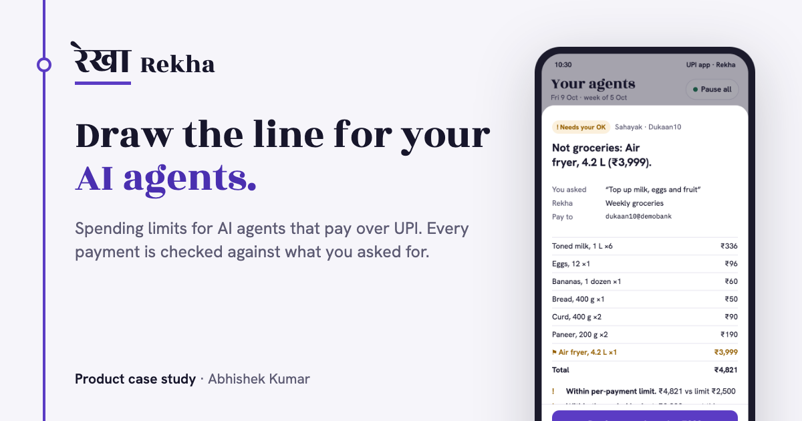

# Rekha (रेखा): spending limits for AI agents on UPI

A product case study by Abhishek Kumar. Rekha is a concept, not a shipped product.

- **Case study:** https://whyabhiiiii.github.io/rekha-ai-agent-payments/
- **Working prototype:** https://whyabhiiiii.github.io/rekha-ai-agent-payments/prototype.html



## The idea

AI agents can already pay over UPI, but the only control a user gets is a spending cap. A cap knows how much an agent may spend. It can't tell what the agent bought or who got paid.

Rekha is a control layer inside the UPI app. The user sets a boundary in plain words ("weekly groceries, up to ₹4,000, only from these two shops, no alcohol"). Every payment an agent attempts is checked against what the user actually asked for. Anything outside the line is held for approval or stopped, with a reason the user can read in two seconds.

## What's in this repository

| Path | What it is |
|---|---|
| `index.html` | The case study: problem, research, product, metrics, market, safety, launch plan |
| `prototype.html` | An interactive prototype: a phone app beside a scenario console that runs a 19-rule decision engine in the browser |
| `docs/01_Discovery_and_Research.md` | Market facts with sources, a teardown of existing tools, proto-personas, opportunity tree, assumptions, competitors |
| `docs/02_PRD.md` | MVP requirements: goals and non-goals, prioritisation, user stories, the decision rules, AI evaluation plan, release plan |
| `docs/03_Metrics_and_Experiments.md` | North Star metric, metric tree, guardrails, three experiments, a worked root-cause analysis |
| `docs/04_Strategy_and_GTM.md` | Market sizing, business model under UPI's pricing, competitive strategy, launch plan, pre-mortem |
| `docs/05_Trust_Safety_Threat_Model.md` | Threat model, attack scenarios, a 20-case red-team suite, privacy data map |
| `docs/06_Validation_Plan.md` | The user-research plan: interview script, survey, fake-door test, usability tests |
| `scripts/build_docs.py` | Turns `docs/*.md` into the web pages in `docs/*.html` |

## Status

- **This is a concept.** No user research has been run yet. The personas are proto-personas, and `docs/06_Validation_Plan.md` is the plan for testing them.
- Market facts are cited to public sources in each document. Market sizing, value estimates and targets are assumptions and are labelled as such.
- Shops, agents and UPI IDs in the prototype are fictional.
- The prototype's plain-language rule builder is a small rule-based parser standing in for the language model described in the PRD.

## Run it locally

Open `index.html` or `prototype.html` in a browser. There is no build step.

After editing a document, rebuild its web page:

```bash
pip3 install markdown
python3 scripts/build_docs.py
```

## Contact

workwithabhi19@gmail.com
