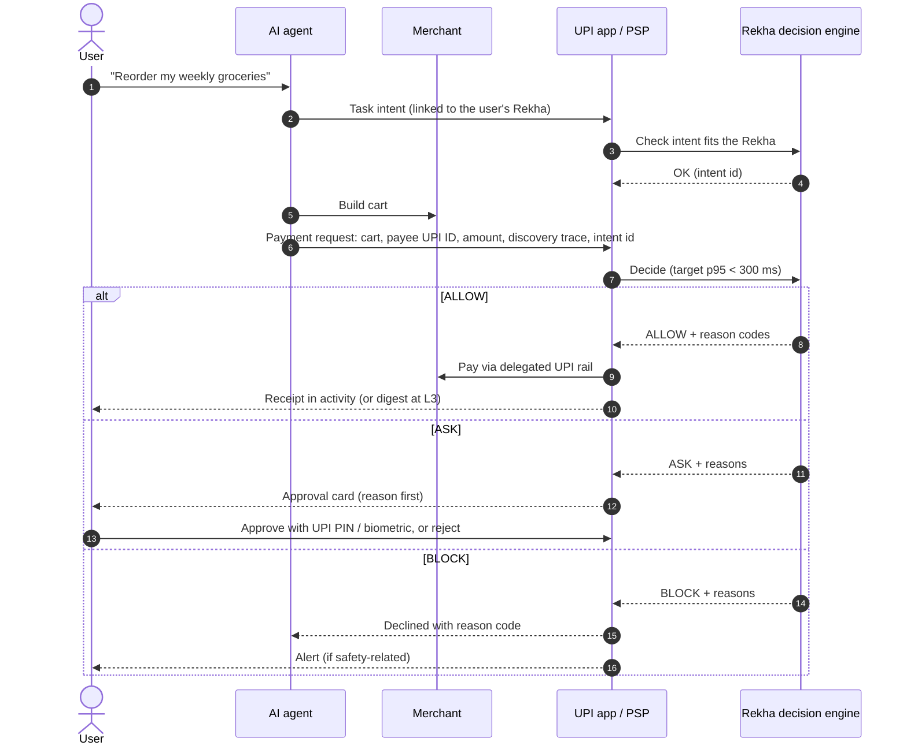
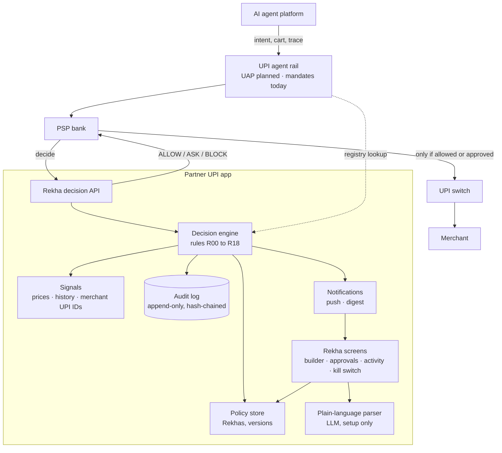

# 02 · PRD: Rekha MVP

| | |
|---|---|
| **Product** | Rekha: agent spending controls inside a UPI app |
| **Author** | Abhishek Kumar |
| **Status** | Draft v1.0, ready for review |
| **Last updated** | 17 Nov 2026 |
| **Assumptions** | An agent-delegation rail exists on UPI: NPCI's planned Unified Agent Protocol (launch reported paused, Sept 2026) or today's mandate-based agent payments (one-time mandates, Reserve Pay). Limits shown are UPI Circle's full-delegation caps, used as placeholders until agent limits are published. |
| **Reviewers (intended)** | Engineering lead, Design lead, Risk & Fraud, Legal & Compliance, Partnerships (agent platforms), PSP bank partner |
| **Related** | `01_Discovery_and_Research.md` · `03_Metrics_and_Experiments.md` · `05_Trust_Safety_Threat_Model.md` |

---

## TL;DR

Agents can already pay over UPI (Pine Labs P3P since June 2026; Razorpay × NPCI checkout pilots in ChatGPT and Claude), and NPCI has been preparing a Unified Agent Protocol to scale it (its launch was reported paused in September 2026, pending regulatory clearance). But users only get an amount cap. Rekha adds the missing layer: **users draw boundaries ("Rekhas") in plain language, every agent payment is checked against what the user actually asked for, and anything outside the line is held for approval or stopped, with a clear reason and a one-tap way back.**

MVP scope: connect an agent, create a Rekha (plain language or template), real-time decision engine (allow / ask / block), reason-first approvals, activity with explainable receipts, kill switch, Intent Lock, Injection Shield v1, weekly digest, and a basic "report a problem" flow that generates an evidence pack.

**Success in the 12-week pilot:** ≥ 35% of pilot users create a Rekha in week 1; ≥ 60% of agent payments complete without a step-up; dispute rate ≤ 0.3%; false-block rate ≤ 2%; added decision latency p95 < 300 ms.

---

## 1. Problem

See `01_Discovery_and_Research.md`. In short:

- **Trust gap:** 74% are open to an agent doing shopping tasks for them; 9% are open to an agent buying on its own, even with guardrails they set (Accenture, 2026).
- **Rails are amount-only:** UPI Circle full delegation caps at ₹15,000/month and ₹5,000/transaction, but can't express *what* or *from whom*.
- **Agents can be manipulated:** prompt injection can make an agent pay the wrong merchant or buy the wrong thing while staying inside a cap.
- **No clear way back:** liability for agent payments is unresolved (it is one of the reported reasons NPCI's launch is paused); users fear "the bank will say I authorised it".

---

## 2. Goals and non-goals

### Goals (pilot)

| # | Goal | Measured by |
|---|---|---|
| G1 | Make delegation feel controllable | % of pilot users with ≥ 1 active Rekha; "I feel in control" score ≥ 4.2/5 |
| G2 | Let agents complete routine payments without constant approvals | % of agent payments auto-allowed (target ≥ 60% by week 8) |
| G3 | Stop payments that don't match intent | Recall on seeded red-team attacks ≥ 95%; confirmed agent-fraud losses = 0 |
| G4 | Don't get in the way of legitimate payments | False-block rate ≤ 2%; payment success rate within 1 pp of non-agent UPI |
| G5 | Make mistakes recoverable | Median time from "report a problem" to evidence pack < 10 s; dispute rate ≤ 0.3% |

### Non-goals (MVP)

- **Not an agent.** Rekha never shops, browses or chooses products.
- **Not a new payment rail.** We sit on the UPI agent rail: UAP when it launches, mandate-based agent payments until then. We never move money ourselves.
- **No raising rail limits.** Rekha can only be *stricter* than NPCI/UPI caps, never looser.
- **No P2P payments by agents** (sending money to individuals). This is a deliberate safety choice; most authorised-push-payment fraud lands in individual accounts.
- **No credit/BNPL funding** in MVP (RuPay-credit-on-UPI is a later phase).
- **No merchant-facing product** in MVP.
- **No ML risk model in MVP.** Rules first, with shadow-mode data collection for a model in phase 2.
- **No standalone app.** Rekha ships inside a partner UPI app (see `04_Strategy_and_GTM.md`).

---

## 3. Concepts and glossary

| Term | Meaning |
|---|---|
| **Agent** | AI software the user links to pay on their behalf. "Registered" means listed in NPCI's agent registry, once that exists. |
| **Rekha** | A boundary the user sets for an agent: purpose, merchants/categories, budget and period, exclusions, autonomy level, expiry |
| **Intent** | What the user asked the agent to do for a specific task ("reorder last week's groceries"). Submitted by the agent and checked against the Rekha. |
| **Cart** | What the agent is actually trying to buy: items, quantities, prices, merchant, payee UPI ID |
| **Intent Lock** | The check that the cart matches the intent and the Rekha |
| **Injection Shield** | Checks for signs the agent was manipulated: payee swaps, price anomalies, untrusted provenance, injection indicators |
| **Decision** | ALLOW, ASK (step-up approval), or BLOCK, always with reason codes |
| **Autonomy level** | L0 Ask every time · L1 Ask only when unusual · L2 Auto, notify after · L3 Auto, weekly digest only |
| **Kill switch** | One tap to pause every agent immediately |
| **Evidence pack** | Signed bundle of the Rekha, intent, cart, decision, reasons and timestamps for a dispute |

---

## 4. Users and hero scenarios

Primary user for MVP: **Priya, the Delegator** (urban, AI-native, frequent quick-commerce shopper). Guardians and cautious bill-payers come in Phase 2 via Family Rekha.

| # | Scenario | Expected Rekha behaviour |
|---|---|---|
| H1 | Agent reorders weekly groceries, ₹1,840, from an allowed quick-commerce merchant | **ALLOW** silently (L1), receipt in activity |
| H2 | Same order, but agent adds a ₹3,999 air fryer it saw as a "deal" | **ASK**: "This isn't groceries. Your agent added an air fryer (₹3,999)." |
| H3 | A product page hides an instruction; agent tries to pay a new UPI ID not belonging to the merchant | **BLOCK**: "The payee doesn't match the merchant your agent was shopping at." User alerted. |
| H4 | Agent pays the electricity bill, ₹2,310, to the usual biller | **ALLOW** (bill-pay Rekha, L2) |
| H5 | Agent tries to send ₹4,500 to an individual "for the refund" | **BLOCK**: agent payments to individuals are off |
| H6 | Agent orders 12 kg of onions instead of 1.2 kg | **ASK**: quantity is 10× your usual |
| H7 | Phone stolen / agent account compromised | User or guardian hits **kill switch** on another device or by calling support; all agents pause |

---

## 5. Prioritisation

### RICE (pilot of 50,000 users, one quarter)

Impact scale: 3 = massive, 2 = high, 1 = medium, 0.5 = low. Effort in person-months.

| Rank | Feature | Reach | Impact | Confidence | Effort | **RICE** |
|---|---|---|---|---|---|---|
| 1 | Kill switch | 50,000 | 1 | 90% | 0.5 | **90,000** |
| 2 | Reason-first step-up approvals | 45,000 | 2 | 80% | 2 | **36,000** |
| 3 | Activity feed + explainable receipts | 50,000 | 1 | 90% | 1.5 | **30,000** |
| 4 | Plain-language Rekha builder + templates | 50,000 | 2 | 80% | 3 | **26,667** |
| 5 | Intent Lock | 50,000 | 3 | 70% | 4 | **26,250** |
| 6 | Weekly agent digest | 50,000 | 0.5 | 80% | 1 | **20,000** |
| 7 | Injection Shield v1 (rules) | 50,000 | 3 | 50% | 5 | **15,000** |
| 7 | Trust Ramp | 30,000 | 2 | 50% | 2 | **15,000** |
| 9 | Verified-agent badge (registry) | 50,000 | 1 | 50% | 3 | **8,333** |
| 10 | Family Rekha (guardian mode) | 8,000 | 3 | 60% | 5 | **2,880** |
| 11 | One-tap dispute + evidence pack | 5,000 | 2 | 60% | 4 | **1,500** |

### Where I overrode the score, and why

1. **Injection Shield goes into the MVP despite ranking 7th.** RICE measures expected value; it doesn't capture tail risk. One public story ("AI agent tricked into paying a scammer through UPI") would set back trust for the whole category and could get the pilot paused by the partner bank. Safety is a **launch gate**, not a backlog item.
2. **A "report a problem" flow with an evidence pack goes in (lite version) despite ranking last.** The PSP bank partner needs a dispute trail before agreeing to the pilot. It's a **dependency for launch**, not a feature competing for users.
3. **Trust Ramp moves to P1 despite tying with Injection Shield.** It needs a few weeks of clean-payment history per user before it can trigger anyway, so building it in month 1 is wasted effort.
4. **Verified-agent badge waits** for the NPCI registry API to be available to apps (open dependency).

### Kano classification

| Must-be (expected; absence = anger) | Performance (more = better) | Attractive (delighters) | Reverse (some dislike) |
|---|---|---|---|
| Kill switch, spend caps, receipts, a dispute path | Fewer approval pings, faster decisions, parser accuracy | "Why did my agent buy this?", weekly digest with savings, Trust Ramp, Family Rekha | Cooling windows: keep them short and explain them |

### MVP scope (MoSCoW)

- **Must:** connect agent, create Rekha (NL + templates), decision engine, Intent Lock, Injection Shield v1, step-up approvals, activity + receipts, kill switch, report-a-problem (lite), audit log
- **Should:** weekly digest, Hinglish input
- **Could:** Trust Ramp (P1), verified badge (P1), Hindi (Devanagari) input (P1)
- **Won't (this release):** Family Rekha (P2), credit-funded payments, merchant product, ML risk model

---

## 6. How a payment flows

---

## 7. Functional requirements

Priority: **P0** = MVP, **P1** = within pilot, **P2** = after pilot.

### Epic 1: Connect an agent (P0)

| ID | User story | Acceptance criteria |
|---|---|---|
| 1.1 | As a user, I want to link an AI agent to my UPI app so it can pay for me within limits I set | **Given** an agent requests linking through the UPI agent rail, **when** I open the request in my UPI app, **then** I see the agent name, developer, registry status and requested permissions, and I can approve with my UPI PIN or decline |
| 1.2 | As a user, I want to know if an agent is registered with NPCI | **Given** the registry confirms the agent, **then** a "Registered agent" label shows. **Given** registry lookup fails, **then** the agent is treated as unregistered: linking is allowed only at L0 |
| 1.3 | As a user, I want linking to create a safe starter Rekha so I'm protected immediately | **When** linking completes, **then** a starter Rekha is created: ₹1,000/week, L0 (ask every time), no P2P, expires in 30 days, and I'm prompted to set up my own |
| 1.4 | As a user, I want to unlink an agent at any time | **When** I unlink, **then** all its Rekhas are revoked immediately, in-flight payments not yet submitted to UPI are blocked, and consent withdrawal is logged (DPDP) |

### Epic 2: Create a Rekha (P0)

| ID | User story | Acceptance criteria |
|---|---|---|
| 2.1 | As a user, I want to describe the limit in my own words | **Given** I type "weekly groceries up to ₹2,500 from Blinkit or BigBasket, no alcohol", **then** I see a structured card within 2 s: purpose=Groceries; merchants=2; budget ₹2,500/week; excludes=Alcohol; autonomy=L1 |
| 2.2 | As a user, I want to confirm the structured version before it's saved | **Then** nothing is saved until I tap "Save Rekha" and enter my UPI PIN. Every field is editable. |
| 2.3 | As a user, I want to be asked when my instruction is ambiguous | **Given** "buy whatever I need", **then** the builder asks for budget and category instead of guessing. **Given** no amount, **then** it proposes ₹1,000/week and highlights it as a default |
| 2.4 | As a user, I want templates for common jobs | **Then** templates exist for: Weekly groceries, Bills & recharges, Medicine refills, Travel tickets, Subscriptions |
| 2.5 | As a user, I can't create a Rekha looser than the rail allows | **Given** I ask for ₹20,000/month, **then** the builder caps it at the rail limit (today: UPI Circle's ₹15,000/month and ₹5,000/payment) and tells me why |
| 2.6 | As a user, I want to type in Hinglish (P0) and Hindi (P1) | "har hafte 2000 tak grocery, daaru nahi" parses to the same card as the English equivalent |
| 2.7 | As a user, I want Rekhas to expire | Every Rekha has an expiry (default 90 days); I get a reminder 7 days before |

### Epic 3: Decision engine (P0)

| ID | Requirement | Acceptance criteria |
|---|---|---|
| 3.1 | Every agent payment request gets a decision: ALLOW, ASK or BLOCK | 100% of requests get a decision plus ≥ 1 reason code; p95 latency < 300 ms, p99 < 600 ms |
| 3.2 | Hard rules produce BLOCK; soft rules produce ASK | See rule table in §8 |
| 3.3 | Decisions are deterministic and replayable | Same inputs give the same decision; every decision is written to the audit log with inputs, rule versions and output |
| 3.4 | Idempotent | A retried request with the same idempotency key returns the original decision and never double-charges |
| 3.5 | Rekha can only tighten, never loosen, rail limits | Any request above the rail's limits is BLOCKed regardless of the Rekha |

### Epic 4: Step-up approvals (P0)

| ID | User story | Acceptance criteria |
|---|---|---|
| 4.1 | As a user, I want to understand in one glance why I'm being asked | The card leads with the reason ("Not groceries: air fryer, ₹3,999"), then agent, merchant, amount, and a cart diff vs my intent |
| 4.2 | As a user, I want rejecting to be as easy as approving | Approve and Reject are equal size; Reject needs no PIN; Approve needs UPI PIN or device biometric |
| 4.3 | As a user, I want approvals only inside my UPI app | Approvals are never sent as SMS links; push notifications open the in-app card |
| 4.4 | As a user, I want pending approvals to expire safely | Unanswered approvals expire after 15 minutes as "not approved"; the agent is told |
| 4.5 | As a user, I want to approve just the allowed part | **Given** a cart with in-Rekha and out-of-Rekha items, **then** I can "Pay for groceries only" and the agent gets a partial approval (P1) |

### Epic 5: Activity and explainable receipts (P0)

| ID | User story | Acceptance criteria |
|---|---|---|
| 5.1 | As a user, I want one feed of everything every agent did | Feed shows payments, asks and blocks across all agents, filterable by agent and Rekha |
| 5.2 | As a user, I want to know why my agent bought this | Each receipt shows: my intent → the cart → which checks passed → decision. Plain language, no codes |
| 5.3 | As a user, I want to see how much of each Rekha is left | Each Rekha shows spent vs budget for the current period, in IST |

### Epic 6: Kill switch (P0)

| ID | User story | Acceptance criteria |
|---|---|---|
| 6.1 | As a user, I want to stop every agent in one tap | One tap plus confirmation pauses all agents within 2 s; pending approvals are rejected; agents are notified |
| 6.2 | As a user, I want to resume safely | Resuming needs UPI PIN; agents resume at their previous autonomy level, or L0 if I choose "resume carefully" |
| 6.3 | As a user without my phone | Kill switch is also available through the partner app's support line and web login (P1) |

### Epic 7: Report a problem / evidence pack (P0-lite, full in P1)

| ID | User story | Acceptance criteria |
|---|---|---|
| 7.1 | As a user, I want to report a wrong agent payment from its receipt | "Report a problem" is on every receipt; choosing a reason generates an evidence pack in < 10 s |
| 7.2 | As a bank dispute team, I need a tamper-evident record | The evidence pack contains the Rekha version, intent, cart, payee, decision, reason codes and timestamps, and is signed and hash-chained to the audit log |
| 7.3 | As a user, I want to track the dispute (P1) | Status updates in the receipt: Raised → With bank → Resolved |

### Epic 8: Weekly agent digest (P0 "should")

| ID | User story | Acceptance criteria |
|---|---|---|
| 8.1 | As a user, I want a weekly summary | Every Sunday 7 pm IST: spent per agent and Rekha, number of asks and blocks, top reasons, and anything that needs attention |

### Epic 9: Trust Ramp (P1)

| ID | User story | Acceptance criteria |
|---|---|---|
| 9.1 | As a user, I want the app to suggest more autonomy once an agent has earned it | **Given** an agent has made ≥ 5 payments under a Rekha at L0 with zero rejects or disputes, **then** I'm offered L1 with a summary of its track record. Never auto-upgraded without my consent. |
| 9.2 | As a user, I want autonomy to drop automatically if something goes wrong | Any BLOCK for a safety reason drops that agent to L0 for 7 days and tells me why |

### Epic 10: Family Rekha (P2)

| ID | User story | Acceptance criteria |
|---|---|---|
| 10.1 | As a guardian, I want to co-approve my parent's agent payments above a threshold | Payments above the guardian threshold (default ₹2,000) need the guardian's approval as well as the parent's |
| 10.2 | As a parent, I want my guardian to see my agents' activity | Guardian sees a read-only activity feed; the parent can revoke guardian access at any time |
| 10.3 | As a guardian, I want to use the kill switch for my parent | Guardian can pause the parent's agents; resume needs the parent's PIN |

---

## 8. Decision engine specification

Checks run on every payment request. **Any BLOCK → BLOCK. Otherwise any ASK → ASK. Otherwise ALLOW** (then the autonomy level decides how the user is notified). All triggered reasons are returned, so the explanation is complete.

| Code | Check | Result | Notes |
|---|---|---|---|
| R01 | Agent unknown (never linked) or registry status revoked | BLOCK | NPCI registry, cached ≤ 24 h. Linked-but-unregistered agents may run only at L0 (R00). |
| R02 | Agent paused by user | BLOCK | |
| R03 | Kill switch on | BLOCK | |
| R04 | No active Rekha for this agent and purpose | BLOCK | |
| R05 | Payee is an individual (P2P) | BLOCK | Unless the Rekha names that contact (P2) |
| R06 | Merchant or category outside the Rekha | BLOCK | Merchant category from the PSP's merchant data |
| R07 | Cart contains an excluded item (e.g. alcohol, tobacco) | BLOCK | Catalog category of each line item |
| R08 | Amount above the Rekha's per-payment limit | ASK | |
| R09 | Period spend + amount above the Rekha budget | ASK | Period in IST |
| R10 | Above the rail's hard caps | BLOCK | Placeholder: UPI Circle's full-delegation caps (₹5,000/payment, ₹15,000/month) until agent limits are published |
| R11 | Intent Lock: cart doesn't match the intent (score < 0.60) | ASK | Category rules + semantic similarity (signal only) |
| R12 | Quantity ≥ 3× the user's usual for that item | ASK | Uses 8-week history; skipped if no history |
| R13 | Unit price ≥ 1.5× the reference median | ASK | Reference from merchant catalog / recent prices |
| R14 | **Payee mismatch:** payee UPI ID isn't the registered UPI ID of the merchant in the discovery trace | BLOCK | Strongest prompt-injection signal |
| R15 | First-time payee and amount > ₹2,000 | ASK + 30-min cooling window | Mirrors RBI's proposed cooling-off idea |
| R16 | Velocity: > 5 agent payments in 10 min, or > 15/day | ASK | |
| R17 | Injection indicators reported by the agent runtime (hidden instructions, instruction-like text in page content) | ASK (BLOCK if combined with R13 or R14) | Depends on agent platform signals |
| R18 | Repeat: the same payee and amount, or an overlapping cart (≥ 60% of the same items, any shop), was already paid in the last 24 h by this or any other agent | ASK | Catches a bill paid twice and two agents doing the same job. The cross-agent view is unique to the user side. |
| R00 | Autonomy level L0 | ASK | "Ask every time" |

**Worked example (scenario H3):** payee `quickdeals.refund@okxyz` ≠ merchant's registered UPI ID → **R14 BLOCK**; also first-time payee for ₹4,200 → R15 ASK. Final: **BLOCK**, reasons R14 + R15. User sees: *"Stopped. The payee doesn't match the store your agent was shopping at. This is a common sign of a manipulated agent. No money left your account."*

---

## 9. AI components and evaluation plan

**Principle: models suggest, rules decide.** AI is used where language is fuzzy; deterministic rules make every money decision. No LLM is on the payment hot path.

| Component | Where AI is used | What decides | Hot path? |
|---|---|---|---|
| Plain-language Rekha builder | LLM turns text into a draft policy | **User confirms** the structured card; a validator enforces caps | No (setup time) |
| Intent Lock similarity | Embedding similarity between intent and cart items | One signal in R11; category rules dominate | Yes, but a small embedding model with cached embeddings (< 20 ms) |
| Explanations | Templates keyed by reason code; LLM used offline only to draft translations | Templates | No |
| Risk model (Phase 2) | Gradient-boosted model trained on shadow-mode labels | Adds a risk score to the rules; can only escalate (ALLOW → ASK), never relax | Yes |

### Eval plan: plain-language Rekha builder

- **Golden set:** 600 utterances: 40% English, 30% Hinglish (Roman script), 20% Hindi (Devanagari), 10% adversarial or ambiguous ("no limit", "whatever's cheapest", "₹2.5k", "dhai hazaar").
- **Labelling:** two annotators per item; disagreements resolved by a third; target Cohen's κ ≥ 0.8.
- **Field metrics and release thresholds:**

| Field | Metric | Threshold |
|---|---|---|
| Amount | Exact match | ≥ 98% |
| Period | Exact match | ≥ 97% |
| Merchants | F1 | ≥ 95% |
| Categories | F1 | ≥ 93% |
| Exclusions | Recall | ≥ 97% |
| **Looser-than-intended rate** (policy allows more than the user said) | Rate | **≤ 0.5%** (safety-critical) |
| Tighter-than-intended rate | Rate | ≤ 5% (annoying, not dangerous) |
| Asks a follow-up when it should | Recall on the ambiguous subset | ≥ 90% |

- **Asymmetric error budget:** looser errors are treated as safety incidents; tighter errors are UX debt. This tells the team where to spend tuning effort.
- **Deterministic guards after the model:** amounts in the policy must appear in the user's text (or be the highlighted default); policy must be within rail caps; unknown merchants are dropped and flagged.
- **LLM-as-judge** is used only for regression tests, after it agrees with human labels ≥ 90% on a calibration set.
- **Regression gate:** the full suite runs on every prompt or model change; a release is blocked if any threshold regresses.

### Eval plan: Intent Lock

- 2,000 labelled (intent, cart) pairs from shadow mode, including 300 seeded mismatches and 100 red-team cases from `05_Trust_Safety_Threat_Model.md`.
- Target: recall on mismatches ≥ 95% at a false-ASK rate ≤ 3%. Threshold (0.60) tuned on the validation split, reported on the held-out split.

---

## 10. Non-functional requirements

| Area | Requirement |
|---|---|
| Latency | Decision p95 < 300 ms, p99 < 600 ms end-to-end inside the PSP call; must not reduce UPI success rate by > 1 pp |
| Availability | 99.95% monthly. **Failure mode:** if Rekha is unreachable, fail *closed* for new payees and amounts > ₹1,000 (ASK); fall back to the rail's own limits plus notification for known billers ≤ ₹1,000 |
| Security | Agent requests signed with the agent's registered key; device binding for approvals; Rekha changes only in-app with UPI PIN, never through an agent; approvals never via SMS links |
| Audit | Append-only, hash-chained decision log; retained for the dispute window plus regulatory minimum; replayable |
| Privacy (DPDP) | Notice and consent at agent linking; purpose limitation (payment control only); data minimisation (store line items 90 days, then aggregates only); no agent browsing history stored beyond the payment's discovery trace; consent withdrawal = unlink + deletion of non-required data |
| Accessibility | WCAG 2.2 AA; screen-reader labels; 48 dp tap targets; decisions never shown by colour alone |
| Localisation | English + Hinglish in MVP; Hindi (Devanagari) in P1; all amounts in ₹ with Indian digit grouping (₹1,50,000) |
| Device | Works on 2 GB RAM Android; module adds < 2 MB to the app |

---

## 11. System architecture

### Key entities

| Entity | Key fields |
|---|---|
| Agent | agent_id, registry_status, developer, public_key, linked_at, autonomy_level, paused |
| Rekha | rekha_id, agent_id, purpose, merchants[], categories[], exclusions[], per_payment_limit, budget, period, autonomy_level, expires_at, version |
| Intent | intent_id, rekha_id, text, structured, created_at |
| PaymentRequest | request_id, idempotency_key, intent_id, merchant_id, payee_upi_id, amount, cart[], trace[] |
| Decision | request_id, decision, reason_codes[], rule_versions, latency_ms, created_at |
| Approval | request_id, shown_at, resolved_at, outcome (approve / reject / expire) |
| Dispute | dispute_id, request_id, reason, evidence_pack_hash, status |

---

## 12. Edge cases

| Case | Behaviour |
|---|---|
| Item out of stock; agent substitutes | Rekha setting "Allow same-category substitutes up to +10% price" (default on for groceries); otherwise ASK |
| Price changes between cart and payment | Re-check at payment; ≤ +5% allowed, otherwise ASK |
| Agent retries after a BLOCK | Same idempotency key returns the same decision; new key counts toward velocity (R16) |
| Approval pending and user offline | Expires after 15 min as "not approved"; agent informed; nothing charged |
| The same order or bill arrives twice within 24 h (from one agent or two) | R18 repeat check → ASK |
| Budget period boundary | Periods computed in IST; weekly resets Monday 00:00 |
| Festive bundles not in the reference catalog | Intent Lock may under-match; mitigation in the RCA playbook (`03`) |
| Merchant changes its UPI ID legitimately | Merchant registry update; first payments to the new ID are ASK |
| User unlinks agent mid-payment | Payments not yet submitted to UPI are blocked; submitted ones complete and appear in activity |
| Kill switch pressed while approvals pending | All pending rejected; agents notified |
| Rail cap exhausted (₹15,000 for the month) | BLOCK with a clear message; Rekha cannot raise it |
| Registry lookup times out | Use cache ≤ 24 h for known agents; treat unknown as unregistered (L0 only) |
| Amount written as words or shorthand ("dhai hazaar", "2.5k") | Parser normalises; validator confirms against text; highlighted in the confirm card |
| Partial refund from merchant | Shown in activity; restores budget for the period |

---

## 13. Instrumentation

| Event | Key properties |
|---|---|
| `agent_linked` | agent_id, registry_status, source |
| `rekha_created` | source (nl / template / form), time_to_create_s, fields_edited, language |
| `rekha_parse_result` | parse_ms, ambiguous_flag, user_edits (diff vs draft) |
| `payment_decision` | decision, reason_codes[], latency_ms, autonomy_level, amount_bucket |
| `stepup_shown` / `stepup_resolved` | reason_codes[], outcome, time_to_decide_s |
| `kill_switch_toggled` | on/off, source (app / support / guardian) |
| `problem_reported` | reason, evidence_pack_ms |
| `digest_opened` | week, items_flagged |
| `trust_ramp_offered` / `trust_ramp_accepted` | agent_id, clean_payment_count |

---

## 14. Release plan

| Phase | Who | What's on | Exit criteria |
|---|---|---|---|
| **0. Shadow mode** (4 weeks) | All agent-payment traffic at the partner (mandate-based agents today, UAP once live) | Engine runs and logs decisions but enforces nothing | Would-be false-block rate ≤ 3% on manual review of 1,000 samples; p95 < 300 ms |
| **1. Closed beta** (4 weeks) | 5,000 users (employees + invited AI-heavy users) | Enforcement on; L0 and L1 only | Dispute rate ≤ 0.3%; no safety incident; CSAT ≥ 4/5 |
| **2. Pilot** (12 weeks) | 50,000 users in Bengaluru, Delhi NCR, Mumbai | L2 on; Trust Ramp experiment; weekly digest | Pilot goals in §2 |
| **3. General availability** | 1% → 10% → 50% → 100% of agent-linked users | Everything in MVP + P1 | Guardrails hold at each step for 7 days |

**Rollback triggers (any one):** false-block rate > 5% for 3 consecutive days · p95 latency > 500 ms for 1 hour · UPI success rate down > 1 pp vs control · any confirmed loss caused by an incorrect ALLOW above ₹10,000 in aggregate per week.

---

## 15. Dependencies, open questions, decisions

### Dependencies

| Dependency | Owner | Risk |
|---|---|---|
| UAP access and agent registry API | NPCI / PSP partner | High: launch reported paused pending regulatory clearance, no public timeline. Fallback: mandate-based agent payments through the PSP. |
| PSP bank decision hook in the payment path | PSP partner | Medium |
| Agent platforms sending intent + discovery trace | Agent partners | High: fallback is Rekha-only checks |
| Merchant registered UPI IDs and catalog categories | PSP / payment gateways | Medium |
| Legal review of liability language | Legal | Medium |

### Open questions

1. **Liability:** when Rekha allows a payment that turns out wrong, who bears the loss? Depends on the liability rules NPCI and RBI settle on. Our evidence pack is designed to make that decision fast whatever the rule is.
2. Will agent platforms pass per-task intent, or only the cart? (Rekha still works with cart + Rekha only, with weaker Intent Lock.)
3. Can Reserve Pay be split into per-Rekha envelopes, or only one block per user?
4. Should guardians in Family Rekha count as RBI's proposed "trusted person"?

### Decision log

| # | Decision | Why | Alternatives rejected |
|---|---|---|---|
| D1 | No LLM in the payment decision | Latency, determinism, auditability | LLM judge on every payment (slow, non-replayable) |
| D2 | Every new agent starts at L0 on a small starter Rekha. When the user sets up their own Rekha, the suggested level is L1 for registered agents. Unregistered agents stay at L0. | A short L0 start is safe and bounded; staying at L0 causes approval fatigue; L2 is too much trust on day 1 | One fixed level for everyone |
| D3 | Agent P2P payments blocked by default | Push-payment fraud mostly lands in individual accounts | Allow with ASK (still exploitable through social engineering) |
| D4 | Fail closed for new payees on outage | A missed grocery order is cheaper than a fraud loss | Fail open (unsafe) or fail closed for everything (breaks bill pay) |
| D5 | Template explanations, not generated | Consistency, translation quality, legal review | LLM-generated explanations |
| D6 | Ship inside a partner UPI app | Distribution, PIN/consent already there, zero-MDR economics (`04`) | Standalone app (needs a TPAP licence, no distribution) |
